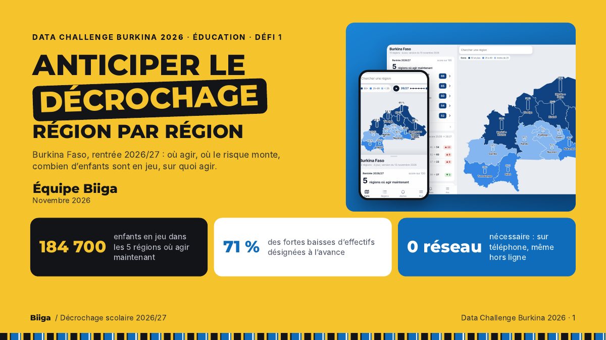
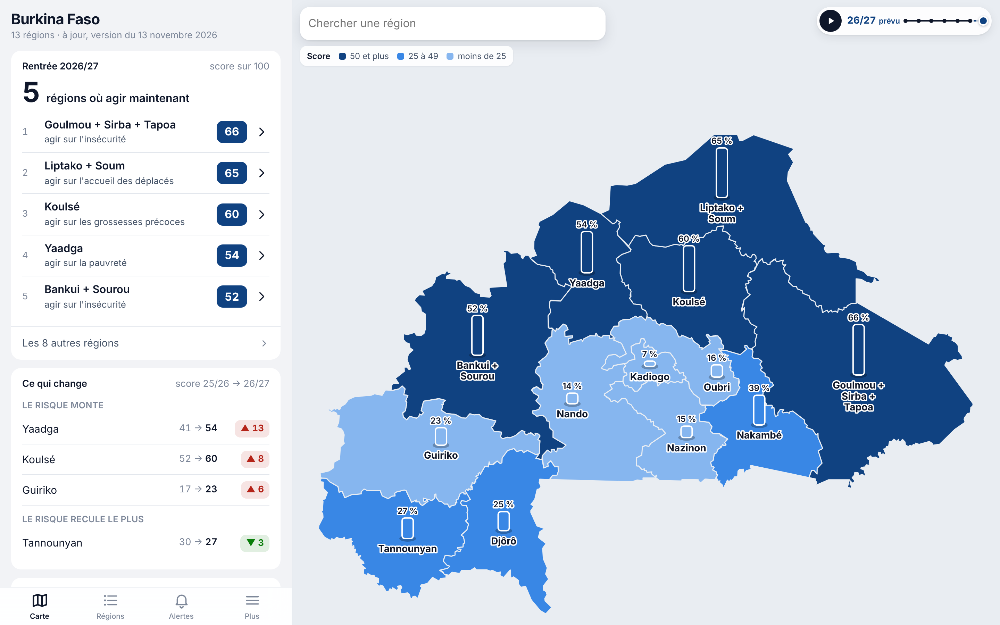
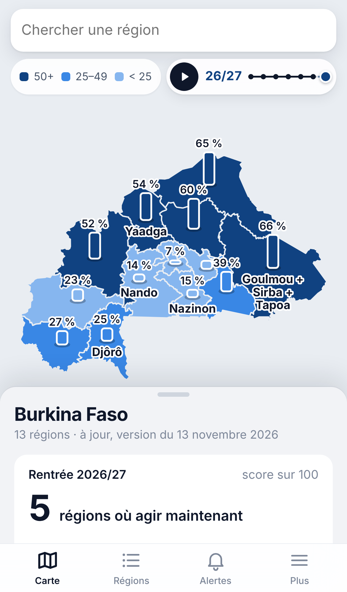
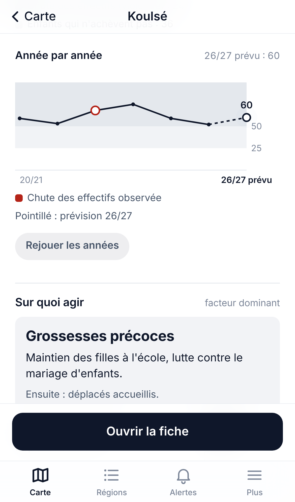
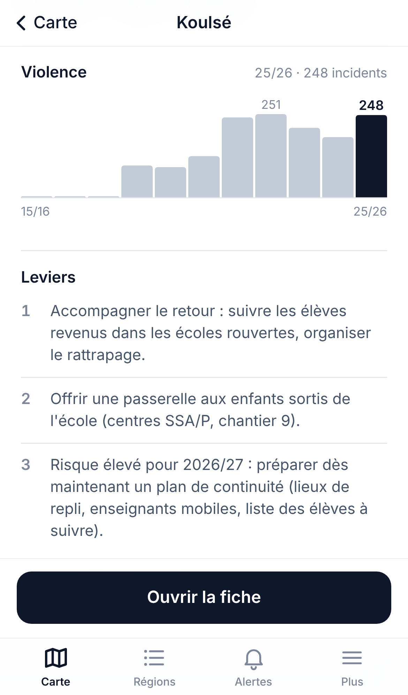
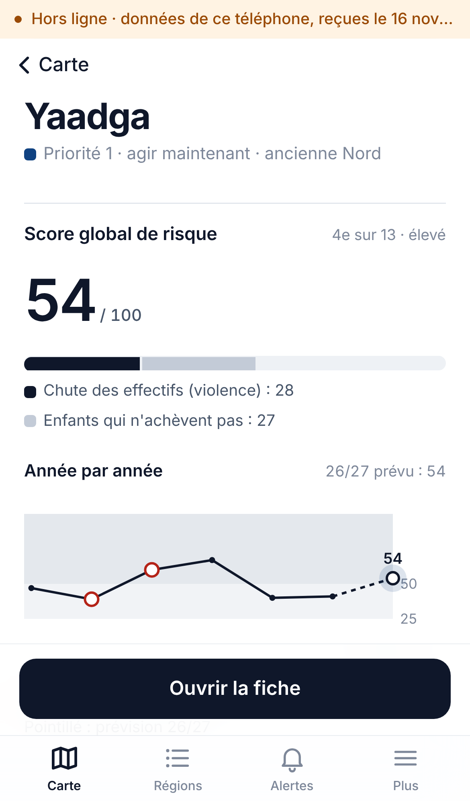

# Anticiper le risque de décrochage scolaire, région par région

**Équipe Biiga** · Data Challenge Burkina 2026, édition Éducation · **Défi 1** : cartographie et anticipation du risque de décrochage scolaire par région.

Une carte du risque pour la rentrée 2026/27, une alerte qui se précise de septembre à janvier, un levier d'action par région, et un tableau de bord qui fonctionne sans réseau.

**Tableau de bord en ligne : <https://kalantigui-decrochage.vercel.app>**

## Le rapport

<a href="05_interpretation/Biiga_05-interpretation_D1_analyst_presentation_v1.pdf"></a>

**[Lire le rapport (PDF, 11 diapositives)](05_interpretation/Biiga_05-interpretation_D1_analyst_presentation_v1.pdf)** : cartographier, anticiper, agir. La carte du décrochage, les cinq régions en alerte pour 2026/27 et la preuve que l'alerte voit juste, le levier de chaque région, l'outil, les données, les modèles testés et la formule retenue, les limites.

En bref :

- **Avant chaque rentrée, l'outil dit au décideur où agir en premier, où le risque monte, combien d'enfants sont en jeu et sur quoi agir dans chaque région**, sur téléphone et sans réseau.
- **Le décrochage prend deux formes.** Brutale : les effectifs chutent quand la violence ferme les écoles. Lente : une part croissante d'enfants n'achève pas le primaire (51,6 % d'achèvement en 2024/25, contre 62,0 % en 2021/22).
- **Un score de 0 à 100 réunit les deux** : moitié probabilité de chute des effectifs, prévue à partir de la violence, moitié part d'enfants qui n'achèvent pas.
- **Un facteur dominant par région** dit sur quoi agir : insécurité, déplacés, pauvreté, grossesses précoces, instruction des mères, préscolaire.
- **Tout est vérifié sur des années que les modèles n'avaient pas vues**, contre la règle « comme l'an passé ».

<br clear="right">

## Le résultat : où agir à la rentrée 2026/27

| Région (nom 2025) | Ancienne région | Score | Risque de chute | Achèvement 2024/25 | Agir sur | Enfants hors CM2 |
| --- | --- | ---: | ---: | ---: | --- | ---: |
| Goulmou + Sirba + Tapoa | Est | 66 | 49 % | 16,5 % | l'insécurité | ≈ 50 600 |
| Liptako + Soum | Sahel | 65 | 41 % | 11,1 % | l'accueil des déplacés | ≈ 28 200 |
| Koulsé | Centre-Nord | 60 | 48 % | 27,7 % | les grossesses précoces | ≈ 42 000 |
| Yaadga | Nord | 54 | 55 % | 46,4 % | la pauvreté | ≈ 28 600 |
| Bankui + Sourou | Boucle du Mouhoun | 52 | 41 % | 37,2 % | l'insécurité | ≈ 35 300 |

Les 13 régions : [`05_interpretation/…_priorites-2026-27_v1.csv`](05_interpretation/Biiga_05-interpretation_D1_analyst_priorites-2026-27_v1.csv). Rejouée sur le passé, cette règle de priorité désignait 35 % des régions et contenait 71 % des fortes baisses d'effectifs de l'année suivante.

## Le tableau de bord



| Carte du score | Le score, année par année | Sur quoi agir | Serveur arrêté |
| :---: | :---: | :---: | :---: |
|  |  |  |  |

Sur téléphone comme sur ordinateur. Les données restent sur l'appareil : l'application s'ouvre et se consulte sans réseau, et la saisie du terrain (écoles ouvertes à la rentrée) part au retour du réseau.

## Le dépôt

Chaque étape a son dossier et son `LISEZ-MOI.md` ; chaque fichier suit le modèle `ÉQUIPE_ÉTAPE_DÉFI_RÔLE_description_vN`.

| Dossier | Contenu |
| --- | --- |
| [`01_collecte/`](01_collecte/) | Note d'intention, liste des sources ; les données brutes à télécharger (`brut/`) |
| [`02_nettoyage/`](02_nettoyage/) | Données du challenge contrôlées et mises au propre, sources externes nettoyées |
| [`03_transformation/`](03_transformation/) | Correspondance 13 / 17 régions, panel région × année, violence, carte, dictionnaire des variables |
| [`04_analyse/`](04_analyse/) | Analyse descriptive, modèles, formule du risque, journal des décisions, tableaux de résultats |
| [`05_interpretation/`](05_interpretation/) | **Le rapport**, les fiches régionales, les priorités 2026/27, les captures |
| [`dashboard/`](dashboard/) | Le tableau de bord (Next.js, fonctionne sans réseau) |
| [`outils/`](outils/) | Construction des notebooks, du rapport et de la soumission ; registre des chemins |

Chaque étape a un **notebook Jupyter déjà exécuté** (`…_notebook-…_v1.ipynb`) : le code et ses résultats se lisent sans rien lancer.

## Lancer en local

```bash
git clone https://github.com/BAGUIAN01/Data-challenge-2026.git
```

```bash
cd Data-challenge-2026
```

**L'analyse** (Python 3.13) :

```bash
pip install -r requirements.txt
```

Placer ensuite les données brutes dans `01_collecte/brut/` : le fichier `.xlsx` du challenge, tel quel, et les sources publiques, aux adresses données dans [`01_collecte/brut/LISEZ-MOI.md`](01_collecte/brut/LISEZ-MOI.md). Puis :

```bash
python outils/construire_notebooks.py
```

Les cinq notebooks sont relancés dans l'ordre des étapes (environ 4 minutes) et redonnent exactement les mêmes résultats. Le rapport se reconstruit avec `python outils/construire_rapport.py` (XeLaTeX).

**Le tableau de bord** :

```bash
cd dashboard
```

```bash
npm install
```

```bash
npm run build
```

```bash
npm start
```

L'application s'ouvre sur <http://localhost:3000>. Sans base de données, elle utilise les données publiées avec elle. Détails : [`dashboard/README.md`](dashboard/README.md).

## Principes

- Chaque modèle est testé sur des années qu'il n'a pas vues, contre la règle « comme l'an passé ».
- Les listes de modèles sont fixées avant de lancer les tests ; ce qui ne marche pas est dit, avec ses chiffres.
- Toutes les sources sont citées ([liste des sources](01_collecte/Biiga_01-collecte_D1_engineer_sources-donnees_v1.csv)) ; aucune donnée personnelle.
