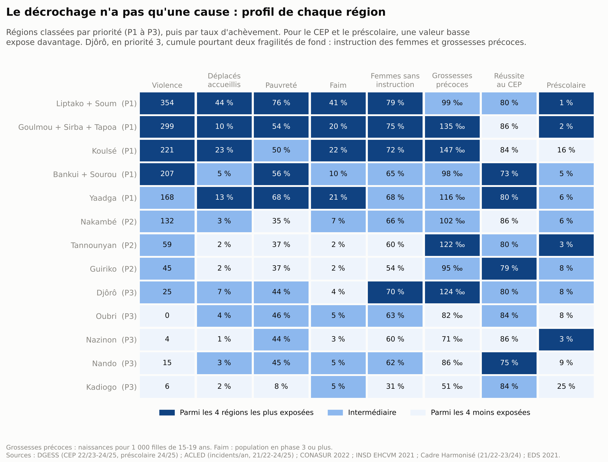

# Défi 1 — Le décrochage n'est pas que l'insécurité : ce que montrent les autres facteurs

*Scripts : `scripts/prepare_facteurs.py` (sources nettoyées dans `data/externe_propre/`), `scripts/facteurs_decrochage.py` (sorties brutes : `analyse/resultats_facteurs_decrochage.txt`, tableaux `P14_*`), figure 16 dans `scripts/figures_approches.py`.*

## Les facteurs mesurés, et d'où ils viennent

| Famille de causes | Indicateur régional | Source |
| --- | --- | --- |
| Insécurité | Incidents par an (2021/22-2024/25) | ACLED (HDX) |
| Déplacements | Déplacés accueillis, en % de la population (fin 2022) | CONASUR (HDX) |
| Pauvreté | Incidence de la pauvreté (2021) | INSD, EHCVM 2021 |
| Faim | Population en phase 3 ou plus du Cadre Harmonisé (2021/22-2023/24) | Cadre Harmonisé (HDX) |
| Famille | Femmes de 15-49 ans sans instruction (2021) | EDS 2021 (HDX) |
| Filles | Grossesses précoces : naissances pour 1 000 filles de 15-19 ans (2021) | EDS 2021 (HDX) |
| École | Réussite au CEP ; taux brut du préscolaire | Données du challenge (DGESS) |

**Pas mesurables avec des données publiques par région :**
- l'orpaillage et le travail des enfants ;
- le mariage précoce lui-même (on n'a que les grossesses précoces, qui en sont une trace) ;
- la distance à l'école ;
- les cantines scolaires ;
- les écoles à cycle incomplet ;
- l'absence des enseignants.

On le dit dans les limites.

## 1. Quels facteurs vont avec un faible taux d'achèvement ?

**Méthode.** Corrélation de rang sur les 13 régions, avec un intervalle à 90 % obtenu en rééchantillonnant les régions. Treize points, c'est peu : ces résultats orientent, ils ne prouvent pas.

| Facteur | Avec le TAP avant la crise (2015-2018) | Avec le TAP 2024/25 | Avec le TAP 2024/25, violence retirée |
| --- | --- | --- | --- |
| Violence (2021-2025) | −0,82 | −0,92 | — |
| **Femmes sans instruction** | −0,77 | −0,85 | **−0,66** [−0,91 ; +0,02] |
| Déplacés accueillis | −0,73 | −0,84 | −0,57 [−0,85 ; +0,21] |
| Pauvreté | −0,44 | −0,69 | −0,47 [−0,76 ; +0,04] |
| Grossesses précoces | −0,82 | −0,73 | −0,30 [−0,75 ; +0,05] |
| Faim | −0,45 | −0,73 | −0,20 [−0,65 ; +0,20] |
| Préscolaire | +0,46 | +0,55 | +0,30 [−0,27 ; +0,85] |
| Réussite au CEP | −0,08 | −0,10 | −0,36 [−0,64 ; +0,05] |

**Lecture :**

- **La fragilité de fond précède l'insécurité.** Les régions frappées aujourd'hui par la violence étaient déjà les plus en retard avant la crise : la violence de 2021-2025 va avec le taux d'achèvement de 2015-2018 (−0,82). Ce sont aussi celles où les femmes sont le moins instruites et où les grossesses précoces sont les plus fréquentes (−0,77 et −0,82 avec le taux d'achèvement d'avant la crise). Lutter contre le décrochage ne peut donc pas se limiter au retour de la sécurité.
- **Une fois la violence retirée, l'instruction des femmes reste le facteur le plus net (−0,66).** Viennent ensuite les déplacés (−0,57) et la pauvreté (−0,47). Les intervalles frôlent zéro : c'est une tendance nette, pas une preuve.
- **Le CEP n'est pas un bon indicateur de risque.** À violence égale, la réussite au CEP est même plus forte là où moins d'élèves arrivent au bout. C'est sans doute un effet de sélection : ceux qui restent jusqu'au CM2 sont les plus solides. On ne le lit pas comme un signe de qualité.

## 2. La faim, le canal par lequel la crise atteint les familles

**Méthode.** Panel de 13 régions sur 2014/15-2023/24. On compare chaque région à elle-même dans le temps (effets fixes). La faim et la violence sont mises ensemble dans le même modèle.

| Effet de +10 points de population en phase de crise alimentaire | Taux d'achèvement | Effectifs |
| --- | --- | --- |
| Région comparée à elle-même | **−4,2 points** [−7,3 ; −2,3] | **environ −17 %** [−23 ; −4] |
| En retirant aussi les chocs nationaux de chaque année | **−5,8 points** [−11,3 ; −4,0] | **environ −21 %** [−27 ; −8] |

- **Une fois la faim dans le modèle, l'effet propre de la violence devient faible** : −0,5 point de TAP [−1,3 ; +0,4] sans effets d'année, −2,2 points [−3,6 ; −0,9] avec.
- **La faim et la violence montent ensemble** (corrélation de 0,61 au sein des régions), parce que les blocus provoquent les deux. On ne peut donc pas les séparer complètement. La lecture prudente : la faim mesure mieux que le nombre d'incidents **ce que la crise fait aux familles**, et c'est par là que les enfants quittent l'école.

**Deux contrôles :**
- **Dans les 9 régions les moins touchées par la violence**, l'effet de la faim va dans le même sens (−4,2 points). Mais la faim y varie trop peu pour conclure : l'intervalle va de −14 à +14.
- **Pour anticiper, la faim ne fait pas mieux que la violence.** Pour annoncer une baisse des effectifs l'année suivante, l'AUC est de 0,72 avec la faim, de 0,82 avec la violence, et de 0,82 avec les deux. La faim explique, la violence alerte.

**Une limite pratique :** le Burkina n'apparaît plus dans le Cadre Harmonisé après la soudure 2024. La variable qui explique le mieux le recul n'est plus publiée.

## 3. Le profil de chaque région : ce qui oriente les leviers

La figure marque, pour chaque facteur, les 4 régions les plus exposées.

- **Les régions en priorité 1 cumulent de 3 à 7 facteurs forts.** Ce n'est pas que la violence.
- **Djôrô (priorité 3)** cumule deux fragilités de fond : femmes sans instruction (70 %) et grossesses précoces (124 ‰). Son taux d'achèvement (53,5 %) est à peine au-dessus de la moyenne.
- **Tannounyan** cumule grossesses précoces et préscolaire très faible.
- **Nazinon** a un préscolaire très faible.
- **Guiriko, Nando, Bankui + Sourou et Yaadga** ont un CEP faible, à lire avec la réserve ci-dessus.

**D'un facteur au levier :**

| Facteur | Levier |
| --- | --- |
| Violence | Continuité éducative : écoles délocalisées, enseignement à distance, radio |
| Déplacés | Places d'accueil, classes passerelles, inscription sans pièces |
| Pauvreté, faim | Cantines scolaires, aides aux familles conditionnées à la scolarité, fournitures |
| Femmes sans instruction | Alphabétisation des mères, associations de mères éducatrices |
| Grossesses précoces | Maintien des filles à l'école, lutte contre le mariage d'enfants |
| Préscolaire faible | Préscolaire communautaire |

## Ce qu'on retient

1. **Le décrochage a des causes de fond plus anciennes que la crise** : instruction des femmes, grossesses précoces, pauvreté. La violence frappe des régions qui étaient déjà fragiles.
2. **La faim est le facteur qui accompagne le mieux le recul dans le temps.** Elle n'aide pas à anticiper mieux que la violence, et elle n'est plus publiée.
3. **La solution garde deux lectures** :
   - **l'urgence** (matrice de priorité : retard et risque qui monte), validée sur le passé ;
   - **le fond** (profil des facteurs), qui choisit les leviers.

   Une région peut être en priorité 3 pour l'urgence et fragile sur le fond (Djôrô).

## 4. Peut-on prédire avec ces facteurs ? Testé : non, ils servent à expliquer

*Script : `scripts/prevision_facteurs.py` (sorties : `analyse/resultats_prevision_facteurs.txt`, tableaux `P15_*`).*

**Ce qui a été testé, sans regarder l'avenir :**
- **la faim de l'année** (Cadre Harmonisé) ;
- **le fond** : femmes sans instruction et grossesses précoces, pris dans la dernière enquête santé déjà publiée (2010, 2014, 2017 ou 2021).

La pauvreté (2021 seulement) et les déplacés (2022 seulement) sont écartés : les utiliser pour des années antérieures reviendrait à regarder l'avenir.

| Ce qu'on cherche à prévoir | Violence seule | + faim | + fond | Référence |
| --- | --- | --- | --- | --- |
| Baisse des effectifs > 5 % l'an prochain (AUC, 78 prédictions) | **0,82** | 0,76 | 0,81 | fond seul 0,67 |
| Variation du TAP l'an prochain (erreur, points) | 4,45 | 5,20 | 4,50 | « comme aujourd'hui » **4,11** |
| Variation du TAP à trois ans (erreur, points ; 2 années testées) | **7,09** | 10,79 | 8,03 | « comme aujourd'hui » 10,41 |

**Lecture :**
- **Ajouter la faim ou le fond n'améliore aucune prévision.** Cela dégrade même l'alerte (AUC de 0,76 au lieu de 0,82).
- **La raison est simple.** Le fond change très lentement, et il est déjà contenu dans le taux d'achèvement d'aujourd'hui, avec lequel il est fortement lié (−0,85 pour l'instruction des femmes). Il n'apprend rien de plus sur ce qui va changer.
- **La faim monte en même temps que le recul, pas avant.** Son saut de 2019/20 a même fait dérailler le modèle (8,7 points d'erreur cette année-là).
- **À trois ans, la violence fait mieux que « comme aujourd'hui »** : 7,1 points d'erreur contre 10,4, soit −32 %. Mais seules deux années ont pu être testées, toutes deux en pleine phase de recul : c'est une piste, pas un résultat établi.

**Ce que ces facteurs apportent quand même :**
- **le pourquoi**, qui choisit les leviers ;
- **des scénarios** : si la faim monte de 10 points dans une région, il faut s'attendre à 4 à 6 points d'achèvement en moins et à environ 20 % d'élèves en moins (estimation tirée du panel).
