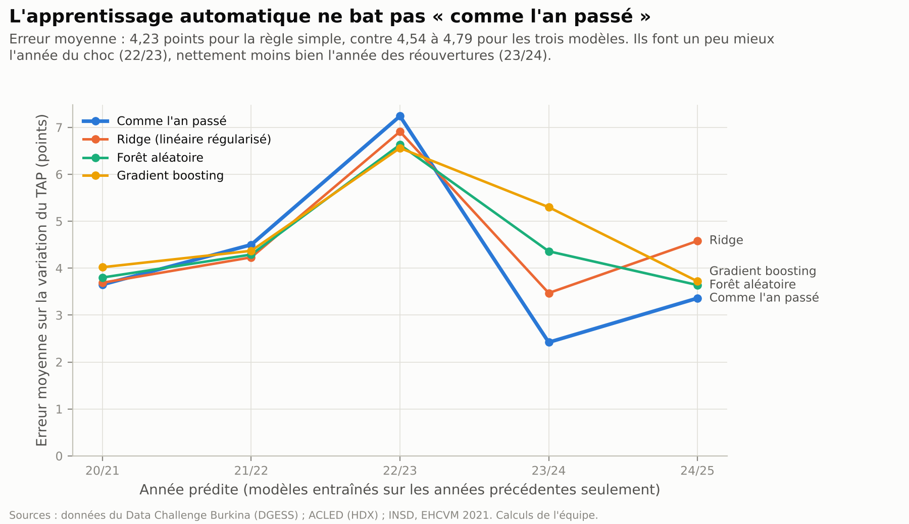
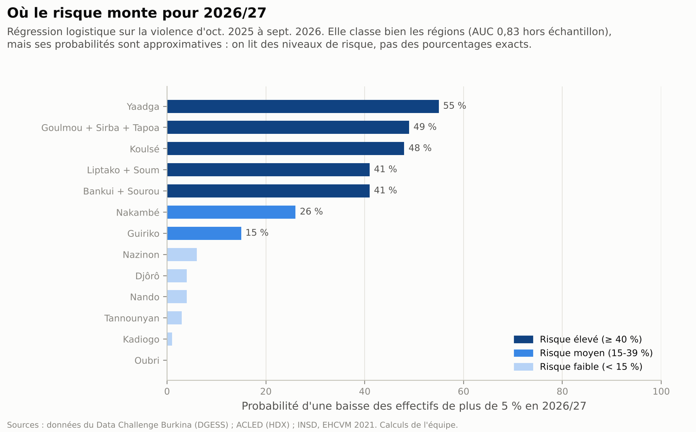

# Défi 1 — L'apprentissage automatique mis en concurrence

*Script : `scripts/machine_learning.py` (sorties brutes : `analyse/resultats_machine_learning.txt`). Figures : `scripts/figures_ml.py`.*

## Protocole

- **104 observations** : 13 régions × 8 années, de 2016/17 à 2023/24. Chacune prédit l'année suivante.
- **15 variables, toutes connues avant la rentrée suivante :**
  - taux d'achèvement, de scolarisation et d'admission ;
  - réussite au CEP ;
  - parité filles/garçons ;
  - variations des effectifs, des écoles et des entrées en CP1 ;
  - part des écoles publiques ;
  - sorties de l'année écoulée ;
  - incidents, escalade et morts (ACLED) ;
  - pauvreté 2021.
- **Validation sur des années non vues.** Chaque année de test (de 2020/21 à 2024/25, soit 65 prédictions) est prédite par des modèles entraînés **uniquement sur les années antérieures**.
- **Réglages fixés à l'avance** (profondeur, régularisation, nombre d'arbres), sans les ajuster sur les années de test. Avec 104 observations, il n'y a pas de place pour un échantillon de réglage séparé.
- **Attention à une fuite de données évitée.** Les « sorties apparentes » d'une année utilisent les effectifs de l'année suivante. On n'a donc utilisé que celles de l'année écoulée.

## 1. Prédire de combien le taux d'achèvement va changer

| Modèle | Erreur moyenne (points) | Par rapport à « comme l'an passé » |
| --- | --- | --- |
| **« Comme l'an passé »** | **4,23** | — |
| Forêt aléatoire | 4,54 | −7 % |
| Ridge (régression linéaire régularisée) | 4,58 | −8 % |
| Gradient boosting | 4,79 | −13 % |

**Aucun modèle d'apprentissage automatique ne bat la règle simple.** Ils font un peu mieux l'année du choc (2022/23 : 6,6 points contre 7,2), puis nettement moins bien l'année des réouvertures (2023/24 : 3,5 à 5,3 points contre 2,4). Ils apprennent que la violence fait baisser l'école, mais ne peuvent pas savoir que l'État rouvrira les écoles.

**Ce que la forêt aléatoire utilise vraiment** (importance par permutation, mesurée sur les années de test) :
1. la variation du taux d'achèvement de l'année écoulée (0,15 point d'erreur gagné) : un effet de **retour vers la moyenne** ;
2. les sorties apparentes de l'année écoulée (0,06 point).

Les autres variables, violence comprise, n'apportent presque rien à cette prévision chiffrée.

## 2. Prédire une forte baisse des effectifs (plus de 5 %)

Les 65 prédictions comptent 14 baisses réelles.

| Modèle | AUC | Brier | Alertes | Baisses annoncées | Précision | Rappel |
| --- | --- | --- | --- | --- | --- | --- |
| Règle d'escalade (décision D7) | 0,68 | — | 14 | 7 | 50 % | 50 % |
| **Logistique, violence seule** | **0,83** | **0,166** | 23 | 9 | 39 % | 64 % |
| Forêt aléatoire | 0,78 | 0,179 | 20 | 9 | 45 % | 64 % |
| Logistique, toutes variables | 0,75 | 0,204 | 19 | 8 | 42 % | 57 % |
| Aucun modèle (taux de base) | 0,50 | 0,169 | — | — | — | — |

Les colonnes se lisent ainsi :
- **AUC** : capacité à classer les régions de la plus à la moins menacée ; 0,5 correspond au hasard.
- **Brier** : justesse des probabilités ; plus c'est bas, mieux c'est.
- **Précision** : part des alertes suivies d'une baisse.
- **Rappel** : part des baisses annoncées.

**Lecture :**
- **Le modèle le plus simple gagne.** Une régression logistique sur deux variables de violence (niveau et escalade) **classe bien les régions** : AUC de 0,83 hors échantillon. Ajouter des variables ou passer à une forêt aléatoire dégrade le résultat. C'est le signe classique du surapprentissage sur peu de données.
- **Ses probabilités sont approximatives.** Son score de Brier (0,166) est à peine meilleur que de donner à toutes les régions le taux moyen (0,169). On l'utilise donc pour **classer et ranger en niveaux de risque**, pas pour annoncer des pourcentages exacts.

## 3. Niveaux de risque pour la rentrée 2026/27

Calculés avec la logistique « violence seule », entraînée sur toute la période, à partir des incidents d'octobre 2025 à septembre 2026. C'est le seul modèle utilisable pour 2026/27, puisque les données scolaires 2025/26 ne sont pas encore publiées.

| Niveau | Régions (probabilité indicative) |
| --- | --- |
| **Élevé** (40 % ou plus) | Yaadga (55 %), Goulmou + Sirba + Tapoa (49 %), Koulsé (48 %), Liptako + Soum (41 %), Bankui + Sourou (41 %) |
| **Moyen** (15 à 39 %) | Nakambé (26 %), Guiriko (15 %) |
| **Faible** (moins de 15 %) | Nazinon, Djôrô, Nando, Tannounyan, Kadiogo, Oubri |

**Yaadga arrive en tête**, et la règle d'escalade la désignait aussi. Guiriko, signalée par la règle, n'est qu'en risque moyen : sa violence augmente vite, mais à partir d'un niveau faible.

## Ce qu'on retient

1. **Pour prévoir un chiffre**, l'apprentissage automatique n'apporte rien ici : la règle « comme l'an passé » reste la référence, avec sa fourchette.
2. **Pour désigner où le risque monte**, un modèle simple sur la violence fonctionne bien (AUC de 0,83). C'est lui qui alimente les niveaux de risque du tableau de bord.
3. **Ces résultats répondent directement au règlement**, qui valorise l'IA utilisée « avec maîtrise et esprit critique ». On a testé honnêtement, gardé ce qui marche, écarté ce qui ne marche pas, et dit pourquoi.
