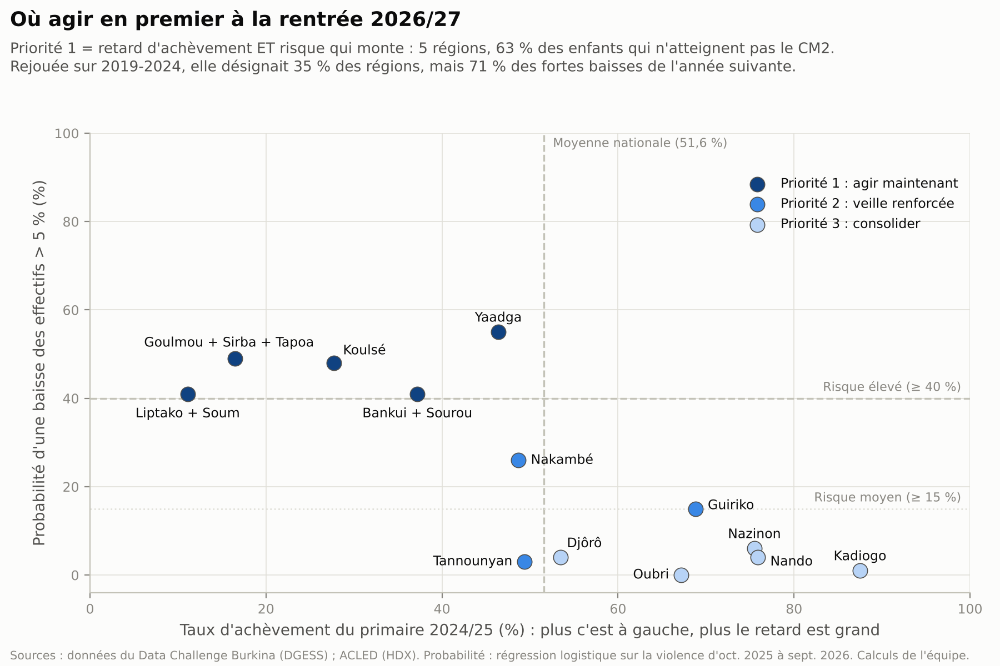

# Défi 1 — La solution : un système d'anticipation en trois questions

*Scripts : `scripts/solution_prevision.py` (sorties brutes : `analyse/resultats_solution_prevision.txt`, tableaux `P13_*`), `scripts/approches_prevision.py` et `scripts/figures_approches.py`.*

Un décideur ne demande pas « de combien de points le taux d'achèvement va-t-il bouger ». Il demande :
1. où agir ;
2. où ça va s'aggraver ;
3. combien d'enfants sont en jeu.

Chaque question a sa méthode. Chacune a été **testée sur des années que la méthode n'avait pas vues**.

## 1. Où sera le risque l'an prochain ? La carte de cette année le prévoit

| Mesure (2016/17 à 2024/25) | Résultat |
| --- | --- |
| Corrélation de rang entre le taux d'achèvement d'une année et celui de la suivante | **0,97** en moyenne (0,94 à 1,00) |
| Les 4 régions les plus en retard une année le sont-elles encore l'année suivante ? | **3,7 sur 4** en moyenne |

**Le retard est très persistant.** C'est une mauvaise nouvelle pour les élèves, mais une bonne nouvelle pour l'anticipation : la carte de cette année désigne de façon fiable les régions de l'an prochain.

**À ne pas utiliser pour classer :** les sorties apparentes. Leur rang change trop d'une année à l'autre (corrélation de 0,27).

## 2. Où le risque va-t-il monter ? L'alerte sur la violence

- **Le modèle :** une régression logistique sur le niveau et l'escalade des incidents (décision D12).
- **Ce qu'elle vaut :** AUC de 0,83 sur des années non vues.
- **Son rôle :** elle repère les régions qui tiennent encore mais où le risque monte, comme Guiriko aujourd'hui ou les Hauts-Bassins avant leur baisse de 2022/23.

## 3. Combien d'élèves ? Il faut le nombre d'écoles ouvertes à la rentrée

**Prévoir à l'aveugle ne marche pas.** Toutes les approches testées ici font moins bien que « comme l'an passé » (9,4 % d'erreur sur la variation des effectifs) :

| Approche testée | Erreur sur la variation des effectifs |
| --- | --- |
| Même variation que l'an passé | 11,0 % |
| Violence | 11,9 % |
| Violence et rebond | 14,1 % |
| Violence, puis écoles, puis élèves | 13,1 % |

Elles annoncent les chocs mais ratent les réouvertures, qui sont des décisions de l'État.

**Dès que le nombre d'écoles ouvertes à la rentrée est connu, l'erreur est divisée par deux** : 4,2 % contre 8,6 % (voir `autres_approches_prevision.md`). Le même calcul chiffre les scénarios de réouverture.

**Au national, la filière des cohortes donne le sens.** Le CM2 devrait remonter en 2025/26 (environ 380 000 élèves contre 354 000). L'enjeu à cinq ans se chiffre aussi : selon que la survie reste basse ou remonte, la génération entrée en CP1 en 2024/25 comptera environ 430 000 ou 572 000 élèves en CM2, soit un écart d'environ 140 000 enfants.

## La sortie : une matrice de priorité

Deux critères, avec des seuils fixés par des décisions antérieures :
- **Retard :** taux d'achèvement sous la moyenne nationale (51,6 %).
- **Risque qui monte :** probabilité de baisse d'au moins 40 % (élevé) ou d'au moins 15 % (moyen).

| Priorité | Règle | Rentrée 2026/27 | Enfants qui n'atteignent pas le CM2 |
| --- | --- | --- | --- |
| **1. Agir maintenant** | retard **et** risque élevé | Liptako + Soum, Goulmou + Sirba + Tapoa, Koulsé, Bankui + Sourou, Yaadga | ≈ 184 700 (63 %) |
| **2. Veille renforcée** | retard **ou** risque moyen | Nakambé, Tannounyan, Guiriko | ≈ 58 300 (20 %) |
| **3. Consolider** | ni l'un ni l'autre | Djôrô, Oubri, Nazinon, Nando, Kadiogo | ≈ 48 600 (17 %) |

**Rejouée sur le passé** (2019/20 à 2023/24), avec seulement l'information disponible chaque année :
- **La priorité 1 visait juste.** Elle désignait 35 % des régions, mais elle contenait 71 % des fortes baisses d'effectifs de l'année suivante (10 sur 14) et 69 % des élèves perdus.
- **Aucune forte baisse n'est tombée en priorité 3.** Les priorités 1 et 2 réunies couvraient toutefois 66 % des régions.

**Limites, dites telles quelles :**
- **L'essentiel vient du retard d'achèvement.** Une liste de même taille fondée sur le seul taux d'achèvement aurait trouvé autant de baisses (10 sur 14). La violence sert surtout à faire monter en veille une région qui tient encore.
- **La matrice ne voit pas les réouvertures.** En 2022/23 et 2023/24, les régions en priorité 1 n'ont pas connu de forte baisse l'année suivante, parce que l'État a rouvert des écoles. Elles restaient pourtant les plus en retard.
- **Peu de cas.** 14 fortes baisses, concentrées sur trois années.

## Ce qui rendrait la solution opérationnelle chaque année

Il faut **le nombre d'écoles ouvertes par région à la rentrée**, que le ministère suit en cours d'année. Branché sur l'outil en octobre, il donnerait la prévision des effectifs de l'année par région, avec une erreur divisée par deux, bien avant l'annuaire statistique.

Ce chiffre n'est pas publié par région. Seuls des bilans nationaux sont publics, par exemple 1 473 structures éducatives rouvertes et 432 281 élèves de retour selon le point de mai 2025 (Sidwaya, 7 octobre 2025).

## Deux lectures : l'urgence et le fond

La matrice répond à « où agir en premier ». Elle repose sur ce qui **anticipe** : le retard d'achèvement et la violence.

Le décrochage a aussi des causes de fond, analysées dans `facteurs_decrochage.md` :
- l'instruction des femmes ;
- les grossesses précoces ;
- la pauvreté et la faim ;
- les déplacements.

Ces facteurs n'améliorent pas l'alerte d'une année sur l'autre, mais ils **choisissent les leviers**, région par région (figure 16). Une région peut être en priorité 3 pour l'urgence et fragile sur le fond, comme Djôrô.

## Un calendrier d'alerte : mieux anticiper au fil de l'année

*Script : `scripts/anticipation_fine.py` (sorties : `analyse/resultats_anticipation_fine.txt`, tableaux `P16_*`), figure 17.*

ACLED donne la violence **par province et par mois**. Six signaux plus fins que le total annuel ont été testés, avec une liste fixée avant de lancer :

| Variante ajoutée à la référence | AUC (65 prédictions, 14 baisses) | Gain et intervalle à 90 % |
| --- | --- | --- |
| Référence : total de l'année, et son escalade (D12) | 0,83 | — |
| Violence de juillet à septembre, juste avant la rentrée | **0,85** | +0,02 [+0,005 ; +0,04] |
| Violence d'octobre à décembre, pendant la rentrée | **0,88** | +0,05 [+0,002 ; +0,11] |
| Attaques contre les civils, au lieu de toute la violence | 0,85 | +0,02 [−0,01 ; +0,05] |
| Part du territoire touchée | 0,79 | −0,04 |
| Violence dans les régions voisines | 0,81 | −0,02 |

- **Les deux signaux qui gagnent portent sur le moment de la violence**, pas sur sa quantité. Ce qui se passe juste avant et pendant la rentrée décide de l'ouverture des écoles.
- **Le gain se retrouve dans chacune des trois années** qui comptent des baisses et des non-baisses : ce n'est pas l'effet d'une seule année.
- **Pour le nombre d'élèves, rien ne bat « comme l'an passé »** : 9,4 % d'erreur. La meilleure variante fait 11,0 %, et la combinaison modèle + « comme l'an passé » 10,1 %.
- **Prudence.** Six variantes testées et peu de cas : les gains sont modestes et restent à confirmer sur les prochaines années.

**D'où un calendrier en trois temps :**

| Quand | Ce qu'on sait | Ce qu'on produit |
| --- | --- | --- |
| **Fin septembre** | Violence de l'année, dont juillet-septembre | Alerte de rentrée : probabilité de baisse par région (AUC 0,85) |
| **Début janvier** | + violence d'octobre à décembre | Alerte mise à jour, des mois avant l'annuaire (AUC 0,88) |
| **Dès que le ministère connaît les écoles ouvertes** | + nombre d'écoles ouvertes par région | Effectifs de l'année, avec une erreur divisée par deux (D13) |

**Ce que donnent les alertes aujourd'hui** (probabilité d'une baisse de plus de 5 %) :

| Région | 2025/26, alerte de janvier | 2026/27, alerte de septembre | 2026/27, référence |
| --- | --- | --- | --- |
| Yaadga | 35 % | **61 %** | 55 % |
| Koulsé | 42 % | 52 % | 48 % |
| Goulmou + Sirba + Tapoa | **61 %** | 48 % | 49 % |
| Bankui + Sourou | 47 % | 41 % | 41 % |
| Liptako + Soum | 36 % | 39 % | 41 % |
| Nakambé | 31 % | 26 % | 26 % |
| Guiriko | 1 % | 20 % | 15 % |
| Les 6 autres régions | 0 à 6 % | 0 à 6 % | 0 à 6 % |

**Pour 2025/26**, l'annuaire n'est pas publié, mais on sait déjà où les effectifs ont probablement le plus baissé : **Goulmou + Sirba + Tapoa** et **Bankui + Sourou**.

**Pour 2026/27**, l'alerte de septembre confirme la matrice, avec deux nuances :
- **Liptako + Soum passe juste sous le seuil de 40 %** (39 % contre 41 %). Elle reste en priorité 1 par son retard, le plus grand du pays, mais elle est à la limite du seuil de risque.
- **Guiriko monte à 20 %.**

La matrice garde le modèle de référence, fixé à l'avance : le gain de la variante est trop faible pour changer de règle en cours de route.
